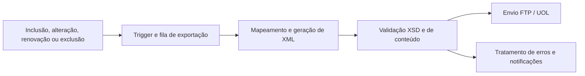
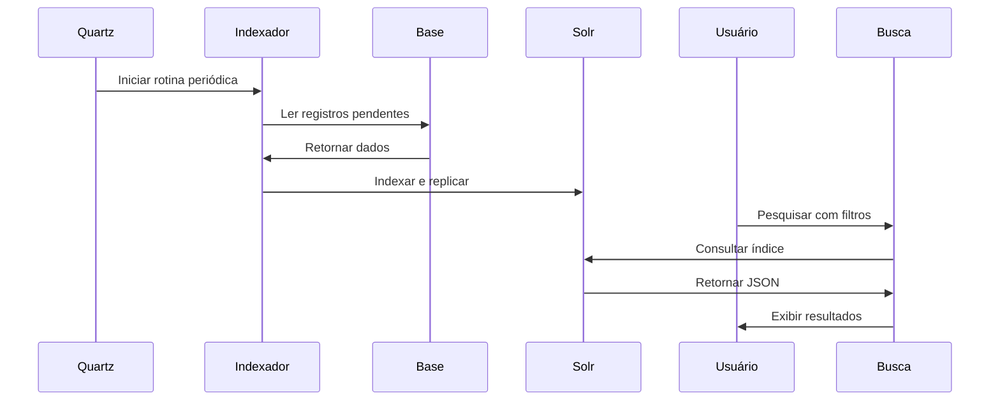

# Empregos / Persona — Buscas, integrações e modernização

Experiência de Carlos Dias de Campos em liderança de desenvolvimento, buscas com Solr, integração com parceiros e modernização do site Empregos.

## Projetos e contribuições

### exportação de vagas para a UOL

**Período registrado:** 2008.

**Objetivo:** distribuir vagas do site Empregos para o portal Emprego Certo, da UOL.

**Minha contribuição:** liderança do desenvolvimento em VB.NET, incluindo identificação de alterações por triggers, fila de exportação, mapeamento dos dados, geração de XML, validação por XSD, envio por FTP e tratamento de erros com e-mail e registro em banco de dados.

**Operação e resultado registrados:** processamento três vezes ao dia e receita mensal aproximada de R$ 250 mil associada ao projeto, conforme meu relato profissional da época.

**Tecnologias e competências:** VB.NET, XML, XSD, FTP, triggers, integração entre plataformas e liderança de desenvolvimento.

### plataforma de busca com Java e Solr

**Objetivo:** indexar vagas e currículos e disponibilizar pesquisas com filtros, relevância e sugestões.

**Minha contribuição:** liderança no desenvolvimento das buscas, com participação na arquitetura, documentação e implementação do backend e do frontend.

- Desenvolvimento de aplicações Java com JPA, Spring e Hibernate para indexação.
- Agendamento com Quartz: vagas a cada três minutos e currículos a cada cinco minutos.
- Configuração de relevância, DisMax, facetas, stopwords e sinônimos.
- Correção de falhas de indexação e configuração de replicação entre servidores.
- Desenvolvimento de cliente próprio para consultas ao Solr e tratamento de respostas JSON.
- Implementação de filtros, autocomplete, paginação, candidatura, visualização e contabilização de cliques.
- Integração de URLs amigáveis com ASP.NET Web Forms e desenvolvimento de componentes reutilizáveis.
- Regras de acesso para recrutadores e funcionalidades de cesta e visualização de currículos.

**Entregas registradas:** buscas de vagas e currículos com frontend ASP.NET/jQuery e backend integrado ao Solr; processamento periódico de indexação e replicação para servidores de consulta.

**Tecnologias e competências:** Java, JPA, Spring, Hibernate, Solr, Quartz, Log4j, C#, ASP.NET, JSON, JavaScript, jQuery e SEO.

### modernização e integração do site

**Objetivo:** evoluir aplicações legadas e integrar funcionalidades comuns ao site.

**Minha contribuição:** atuação como líder e desenvolvedor na migração de sistemas em ASP clássico e Visual Basic, incluindo componentes COM+, intranet e integrações, para .NET Framework 3.5, C# e ASP.NET.

Desenvolvimento do topo compartilhado, da barra de busca e da autenticação de usuários, integrados a mais de 130 páginas ASP. Uso de JavaScript/AJAX e Web Handlers para comunicação entre os componentes. Implementação de exportações XML diárias para Trovit e Buscapé, integradas ao processamento de vagas.

**Tecnologias e competências:** C#, ASP.NET, VB.NET, ASP clássico, COM+, AJAX, Web Handlers, XML e modernização incremental.

## Complementos da pesquisa no HD

Liderança e desenvolvimento de buscas, integrações e modernização de sistemas. Atuação em backend, frontend, intranet, relatórios e SQL Server, com migração de ASP/VB e componentes COM+ para C#/ASP.NET e .NET 3.5.

**Período registrado:** 05/2008 a 07/2012.

## Diagramas dos fluxos

Diagramas reconstruídos a partir dos registros, em nível lógico. Os fluxos conceituais indicam a leitura das responsabilidades descritas e não comprovam a arquitetura física implantada.

### Exportação de vagas

### Pesquisa

## UML de sequência — Indexação e consulta

## Melhorias propostas

Sugestões para evolução ou documentação; não representam entregas já realizadas.

- Adicionar testes de regressão para relevância e filtros de pesquisa.
- Definir identificadores de remessa e reconciliação dos arquivos exportados.
- Documentar separadamente a topologia de cada ambiente: os relatos mencionam três e cinco servidores sem esclarecer a relação entre eles.

## Base documental

Currículos cv-23052020.doc, cv.pdf e cv-05122018.doc; relatos experiencia.txt e resumo-qualificacao-curriculo.txt. Rascunhos/10092010.txt; BuscaAnaliseReformulacao.txt.

Relatos históricos e documentação técnica. Datas divergentes e itens em andamento foram preservados como tais. Este portfólio não contém os documentos originais nem o código-fonte dos sistemas.
